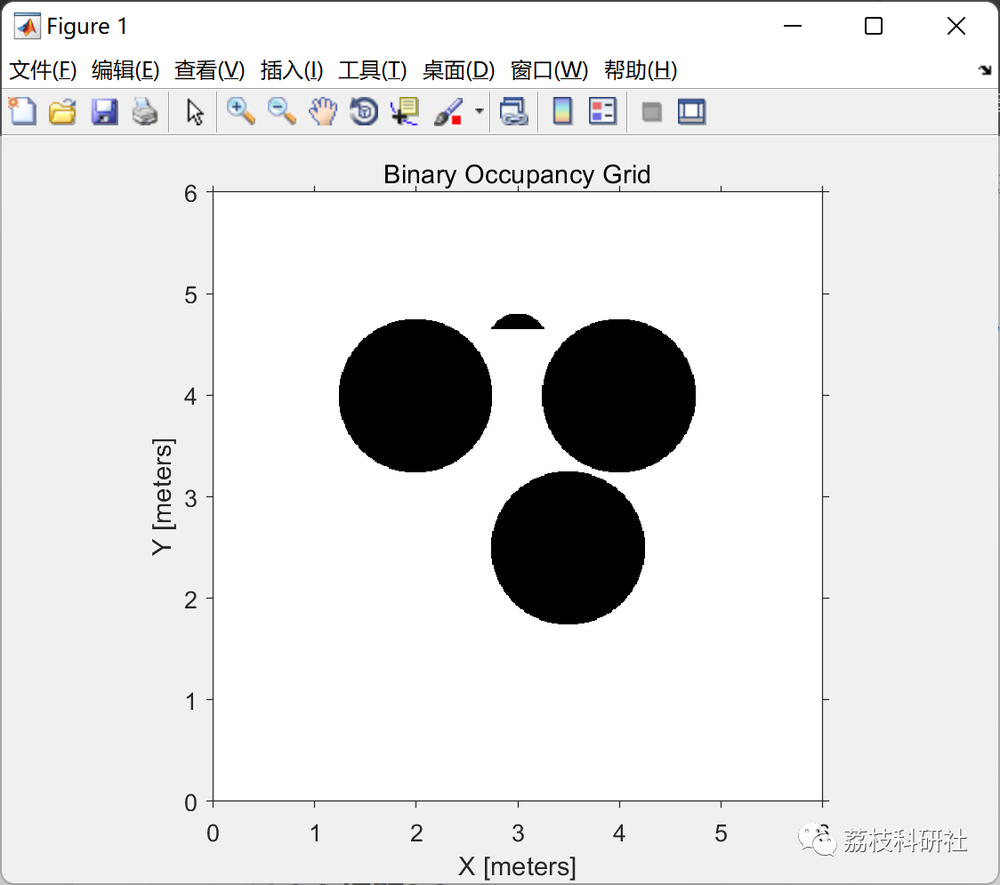
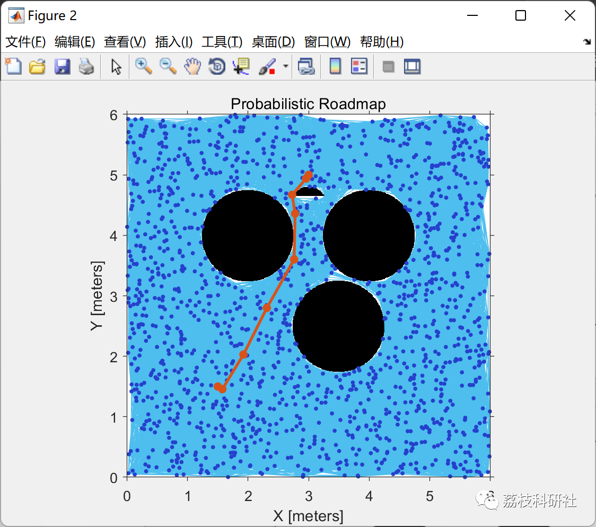
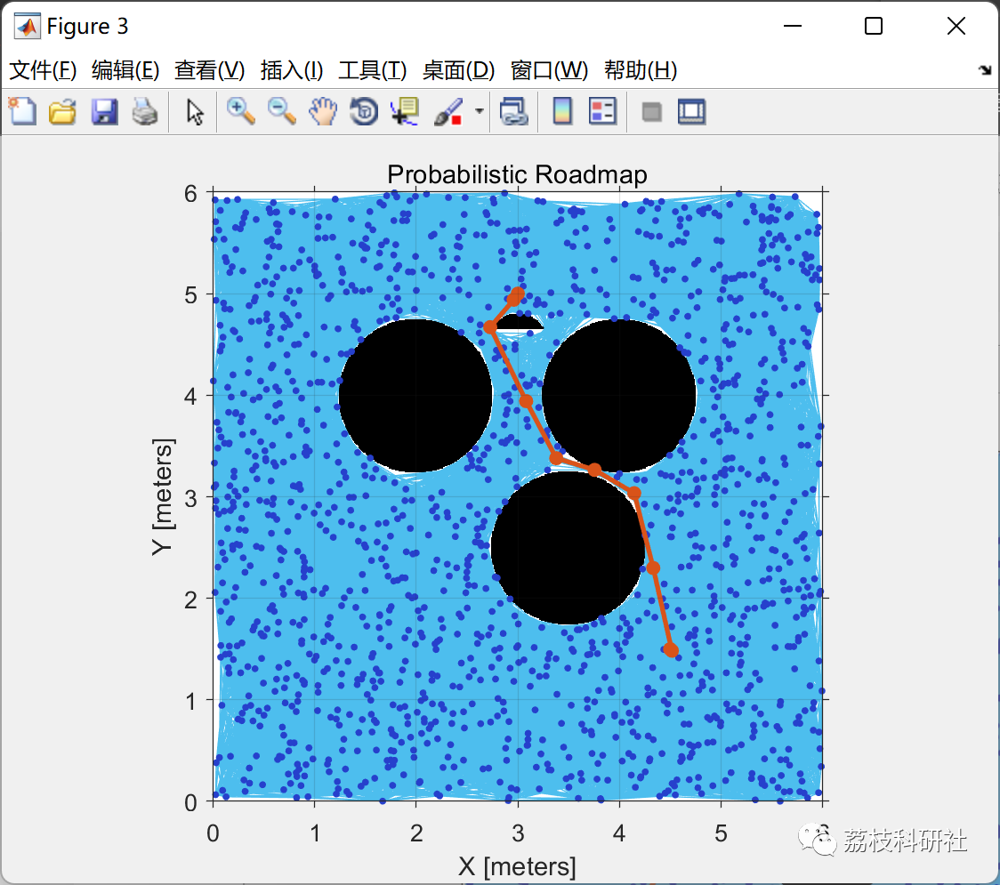
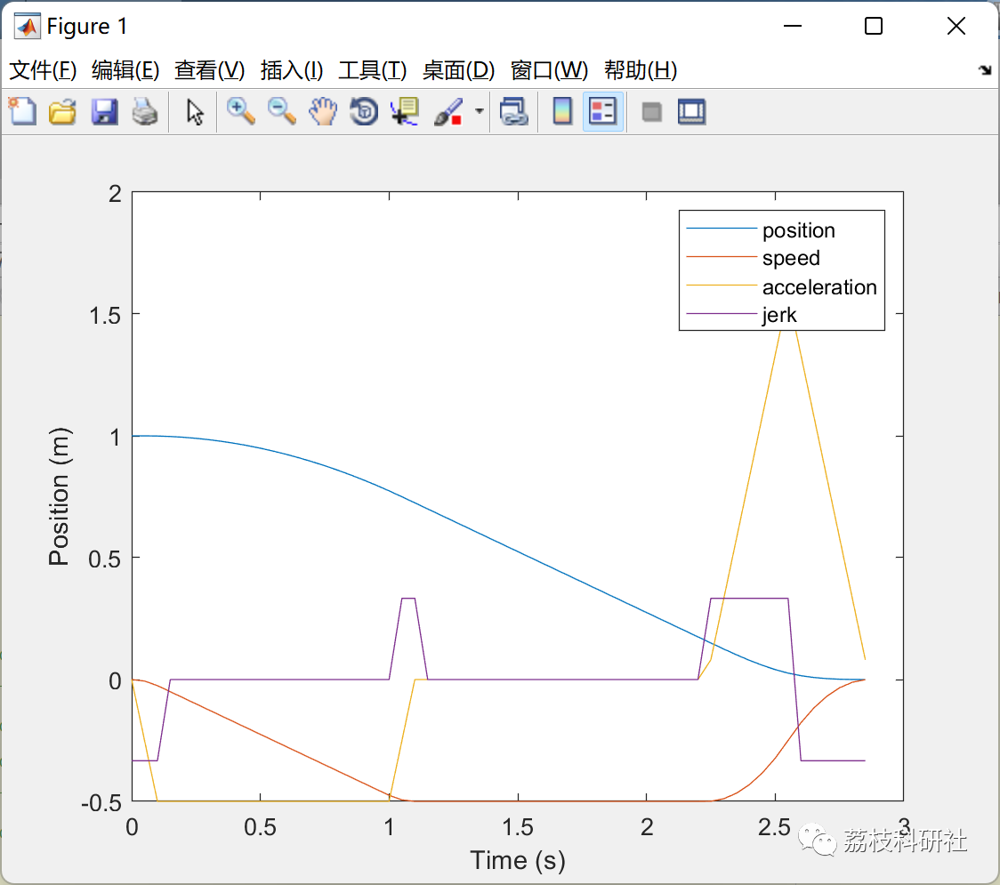
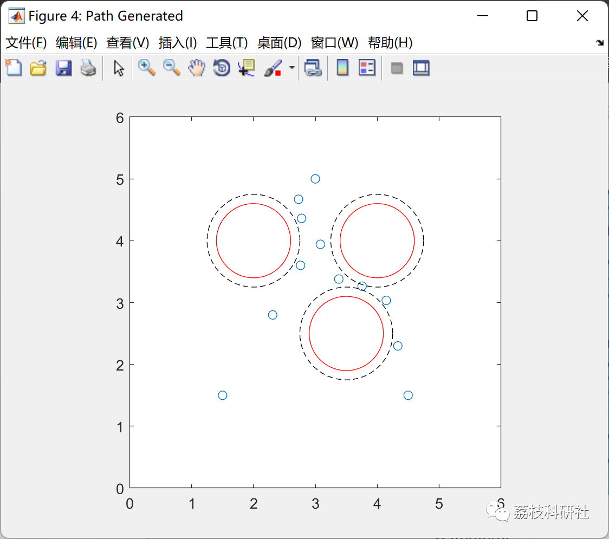
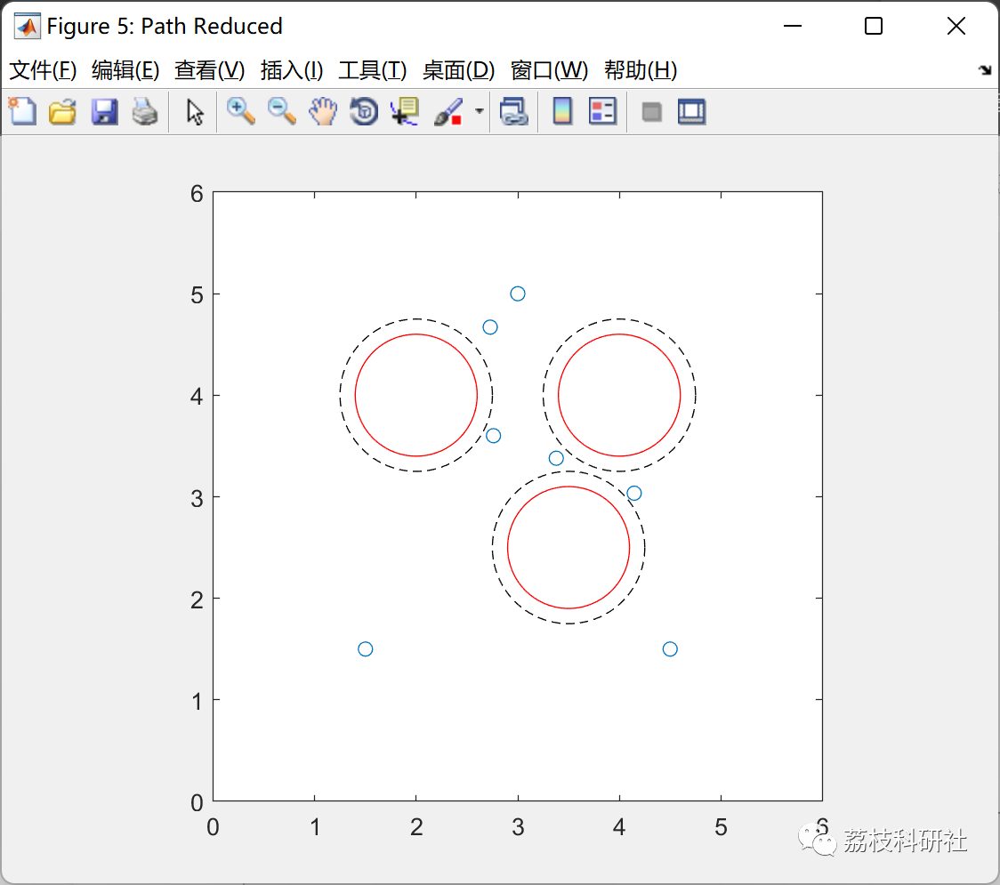
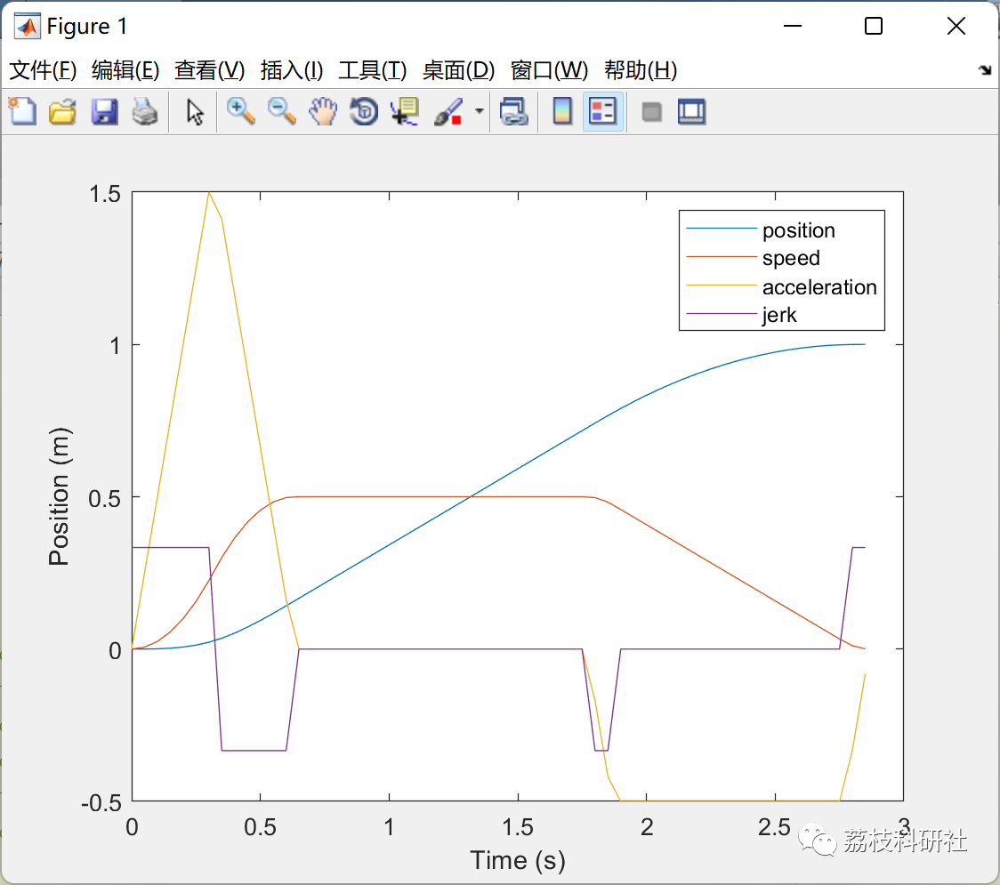

# Implementation of Unmanned Aerial Vehicle Path Planning and Trajectory Algorithm Based on Particle Swarm Optimization Algorithm (Matlab Code)

💥💥💥💞💞💞💞 Welcome to this blog❤️❤️❤️💥💥💥
🏆 Bloggers' Advantage: 🌞🌞🌞 The content of the blog strives to be rigorous in thought and clear in logic, for the convenience of readers.
⛳️ Mantra: The journey of a hundred miles is half done in the last ninety.
Litchi Research Society
Code Collection: Power System, Intelligent Algorithms and Applications, Neural Network Prediction, Path Planning, Optimized Scheduling, Workshop Scheduling, Image Processing, Signal Processing...
🎁Column Directory Link:
🌈🌈🌈🌟🌟🌟🛫🛫🛫🛫🛫🛫🛫🛫🛫🛫🛫🛫🛫🛫🛫🛫🛫🛫🛫🛫🛫🛫🛫🛫🛫🛫🛫🛫🛫🛫🛫🛫🛫🛫🛫🛫🛫🛫🛫🛫🛫🛫🛫🛫🛫🛫🛫🛫🛫🛫🛫🛫🛫🛫🛫🛫🛫🛫🛫🛫🛫🛫🛫🛫🛫🛫🛫🛫🛫🛫🛫🛫🛫🛫🛫🛫🛫🛫🛫🛫🛫🛫🛫🛫🛫🛫🛫🛫🛫🛫🛫🛫🛫🛫🛫🛫🛫🛫🛫🛫🛫🛫🛫🛫🛫🛫🛫🛫🛫🛫🛫🛫🛫🛫🛫🛫🛫🛫🛫🛫🛫🛫🛫🛫🛫🛫🛫🛫🛫🛫🛫🛫🛫🛫🛫🛫🛫🛫🛫🛫🛫🛫🛫🛫🛫🛫🛫🛫🛫🛫🛫🛫🛫🛫🛫🛫🛫🛫🛫🛫🛫🛫🛫🛫🛫🛫🛫🛫🛫🛫🛫🛫🛫🛫🛫🛫🛫🛫🛫🛫🛫🛫🛫🛫🛫🛫🛫🛫🛫🛫🛫🛫🛫🛫🛫🛫🛫🛫🛫🛫🛫🛫🛫🛫🛫🛫🛫🛫🛫🛫🛫🛫🛫🛫🛫🛫🛫🛫🛫🛫🛫🛫🛫🛫🛫🛫🛫🛫🛫🛫🛫🛫🛫🛫🛫🛫🛫🛫🛫🛫🛫🛫🛫🛫🛫🛫🛫🛫🛫🛫🛫🛫🛫🛫🛫🛫
💥1 Overview
With the advancement of science and technology, military and civilian drones have been widely applied due to their small size and fast flight speed. The intelligence of drones is one of the main development directions in their evolution. Three-dimensional path planning for drones is a crucial aspect of their intelligence and also a hot research topic in intelligent control and decision-making. This refers to finding an optimal path from the starting point to the destination under constraints such as terrain, avoiding radar weapons, and meeting flying conditions in different three-dimensional environments. In recent years, numerous researchers both domestically and internationally have conducted studies on enhancing the navigation efficiency of drone path planning. Research has found that introducing optimization algorithms can effectively improve the path planning capabilities of drones while maintaining good stability.
📚2 Running Results
🎉3 References
[1] Wang Xiaolu, Huang Chen, Yu Yuanhang, Chen Fuhao, Hu Die, Lu Qi, Cui Xiyu. Path Planning for Unmanned Aerial Vehicles Based on Particle Swarm Optimization with Fitness Value [J]. Electronic Manufacturing, 2022, 30(16): 16-19. DOI: 10.16589/j.cnki.cn11-3571/tn.2022.16.005.
[2] Zhao Zhi, Duan Lian, Lu Donglin, Zhang Yang, Qiu Xue. 3D Path Planning and Collision Discharge for Unmanned Aerial Vehicles Based on Ant Colony Algorithm [J]. Aerospace Computing Technology, 2022, 52(04):33-37.
👨‍💻4 Matlab Code Implementation
Click the left bottom corner of the article to read more.

## Images

<!-- PAYMENT_BLOCK -->

## Get this dataset

- Payment link (Stripe): [Buy now](https://buy.stripe.com/3cs8yP7sY87d0vu9AB)
- Payment QR code: 

<!-- /PAYMENT_BLOCK -->
